# Arquitectura de Requesto

> **Fuente de verdad de la arquitectura del proyecto.** La sección 2 del `readme.md` es el resumen para la entrega del máster; si hay diferencias, manda este documento.
>
> **Versión:** 1.0 · **Fecha:** 24/09/2026 · **Estado:** diseño previo a la implementación (entrega 2).
>
> Estructura inspirada en arc42, con diagramas **C4** en Mermaid y decisiones en **ADRs** ([`docs/adr/`](docs/adr/README.md)). Los requisitos de producto están en [`PRD/PRD.md`](PRD/PRD.md).

## Índice

1. [Objetivos y requisitos que guían la arquitectura](#1-objetivos-y-requisitos-que-guían-la-arquitectura)
2. [Restricciones](#2-restricciones)
3. [Contexto del sistema (C4 · nivel 1)](#3-contexto-del-sistema-c4--nivel-1)
4. [Estrategia de solución](#4-estrategia-de-solución)
5. [Contenedores (C4 · nivel 2)](#5-contenedores-c4--nivel-2)
6. [Componentes (C4 · nivel 3)](#6-componentes-c4--nivel-3)
7. [Vista de ejecución: flujos principales](#7-vista-de-ejecución-flujos-principales)
8. [Datos](#8-datos)
9. [API](#9-api)
10. [Infraestructura y despliegue](#10-infraestructura-y-despliegue)
11. [Conceptos transversales](#11-conceptos-transversales)
12. [Decisiones de arquitectura (ADRs)](#12-decisiones-de-arquitectura-adrs)
13. [Riesgos, deuda técnica y puntos abiertos](#13-riesgos-deuda-técnica-y-puntos-abiertos)
14. [Glosario](#14-glosario)

---

## 1. Objetivos y requisitos que guían la arquitectura

**Qué es Requesto:** una aplicación web, desplegable on-premise, que sustituye a Jira Service Management Data Center (EOL) para gestionar **un único tipo de ticket (Request)**, con un formulario fijo, un flujo de estados fijo y tres roles (usuario, operador y supervisor). Incluye un agente de IA para explotar la información de los tickets.

**Atributos de calidad**, por orden de prioridad:

| # | Atributo | Qué significa en Requesto | Cómo se consigue |
|---|----------|---------------------------|------------------|
| 1 | **Corrección del flujo** | Ningún ticket puede saltarse el flujo ni un usuario hacer algo que su rol no permite, venga la petición de la SPA, de la API directamente o del agente de IA. | Máquina de estados única en el backend + políticas por rol ([§6.1](#61-backend-api-rest)). |
| 2 | **Soberanía de los datos** | Los datos no salen de la infraestructura de la empresa. | Despliegue on-premise sin servicios gestionados; proveedor LLM configurable ([§10](#10-infraestructura-y-despliegue), [ADR](docs/adr/20260924-agente-ia-solo-lectura-y-proveedor-configurable.md)). |
| 3 | **Trazabilidad** | Se sabe quién cambió qué y cuándo en cada ticket. | Historial inmutable en la misma transacción que el cambio ([§8](#8-datos)). |
| 4 | **Seguridad** | Solo acceden personas autenticadas y cada una ve y hace solo lo que le corresponde. | Sesión con cookie `HttpOnly`, CSRF, autorización en servidor ([§11.1](#111-seguridad)). |
| 5 | **Mantenibilidad** | Un equipo pequeño (o un agente de IA) puede entender y cambiar el sistema con seguridad. | Monorepo TypeScript, capas claras, tests, documentación como código ([§11](#11-conceptos-transversales)). |
| 6 | **Sencillez operativa** | Se instala y actualiza en un servidor de la empresa sin un equipo de plataforma. | Tres contenedores con Docker Compose ([§10](#10-infraestructura-y-despliegue)). |

**No son objetivos:** alta escalabilidad horizontal, multi-tenant, disponibilidad 24/7 con redundancia ni configurabilidad de tipos de ticket o workflows.

## 2. Restricciones

| Tipo | Restricción | Origen |
|------|-------------|--------|
| Negocio | Despliegue **on-premise**; no se migra a JSM Cloud ni a otro SaaS. | PRD, driver |
| Negocio | Un solo tipo de ticket, formulario y flujo fijos. | PRD |
| Técnica | Frontend en **React** con **Vite**; backend en **AdonisJS 7**; base de datos **PostgreSQL**. | Decisión del autor |
| Técnica | **TypeScript** en todo el proyecto; **Biome** como única herramienta de lint y formato. | Decisión del autor |
| Organización | Proyecto final del máster AI4Devs: un único repositorio (fork), entregas en ramas con iniciales y unas 30 h de dedicación. | Enunciado del máster |

## 3. Contexto del sistema (C4 · nivel 1)

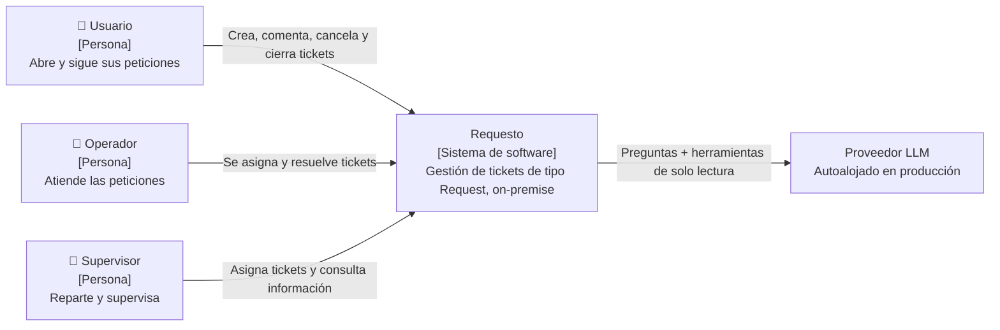

| Actor / sistema | Relación con Requesto |
|-----------------|------------------------|
| Usuario (`requester`) | Abre tickets, comenta, cancela los suyos y cierra los resueltos. |
| Operador (`agent`) | Se asigna tickets y los mueve por el flujo hasta resolverlos. |
| Supervisor (`supervisor`) | Todo lo del operador, además de asignar tickets a otros y consultar la información. |
| Proveedor LLM | Autoalojado dentro de la infraestructura de la empresa cuando se habilita el agente en producción. Recibe las preguntas y los resultados de herramientas de lectura. Se permite una API externa en desarrollo y demos solo con preguntas y datos sintéticos. |

## 4. Estrategia de solución

| Decisión | Motivo | ADR |
|----------|--------|-----|
| **Cliente-servidor: SPA React + API REST** en AdonisJS | Un contrato de API explícito que usan la SPA y el agente de IA; front y back independientes. | [SPA + API REST](docs/adr/20260924-spa-react-y-api-rest-en-lugar-de-inertia.md) |
| **Monolito modular por capas** en el backend | Dominio pequeño y cerrado; microservicios solo añadirían complejidad operativa on-premise. | — |
| **Máquina de estados** en la capa de dominio | Una única fuente de verdad para transiciones y permisos del flujo. | — |
| **Sesión con cookie `HttpOnly`** | Herramienta interna bajo un solo dominio; sin tokens accesibles desde JavaScript. | [Sesión con cookie](docs/adr/20260924-autenticacion-por-sesion-con-cookie.md) |
| **Reglas críticas también en la base de datos** | Restricciones CHECK/FK y prioridad como columna generada: los datos son correctos aunque falle una capa superior. | [Prioridad generada](docs/adr/20260924-prioridad-como-columna-generada.md) |
| **Agente de IA con herramientas de solo lectura** | Reutiliza los servicios de dominio y sus permisos; sin SQL libre ni escrituras. | [Agente de IA](docs/adr/20260924-agente-ia-solo-lectura-y-proveedor-configurable.md) |
| **Monorepo con npm workspaces** | Un repositorio para la entrega; cambios de API y SPA en la misma PR. | [Monorepo](docs/adr/20260924-monorepo-con-npm-workspaces.md) |

## 5. Contenedores (C4 · nivel 2)

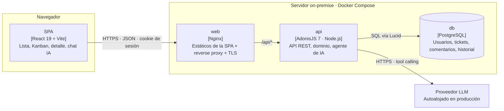

| Contenedor | Tecnología | Responsabilidad |
|------------|------------|-----------------|
| **SPA** | React 19, Vite, TypeScript, React Router, TanStack Query, dnd-kit | Interfaz: login, lista con filtros, Kanban, detalle con comentarios e historial, formulario de creación y chat con el agente. Muestra solo las acciones permitidas, pero **no decide** qué está permitido. |
| **web** | Nginx | Sirve el build de la SPA, redirige `/api/*` a la API y termina TLS. Al compartir dominio, no hace falta CORS. |
| **api** | AdonisJS 7, TypeScript, Lucid, VineJS, `@adonisjs/auth`, Bouncer | API REST, autenticación, autorización, reglas de negocio, historial y agente de IA. |
| **db** | PostgreSQL | Persistencia con restricciones de integridad, índices y la prioridad calculada. |

## 6. Componentes (C4 · nivel 3)

### 6.1 Backend (API REST)

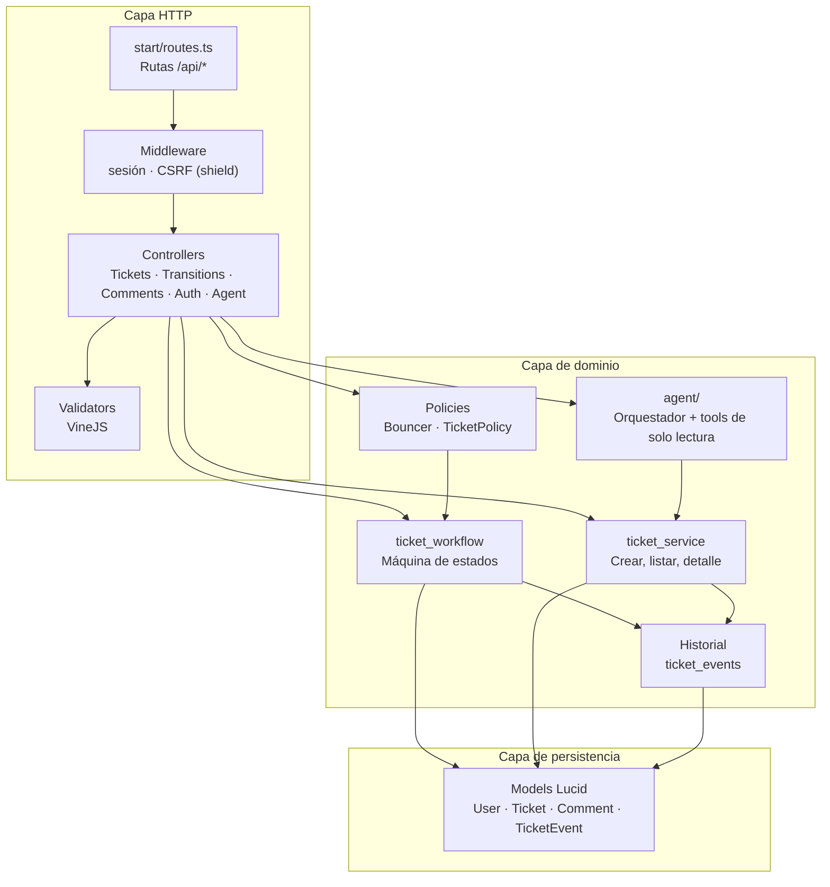

**Reglas de dependencia entre capas:**
- Los **controllers** solo validan (VineJS), autorizan (Bouncer) y delegan. No contienen reglas de negocio ni consultas.
- Los **servicios de dominio** no conocen HTTP: reciben datos y el usuario que actúa, y lanzan **errores de dominio tipados** (`InvalidTransitionError`, `ForbiddenTransitionError`, `StaleTicketError`).
- El **exception handler** global traduce los errores de dominio a HTTP (`422`, `403`, `409`).
- El **agente de IA** solo llama a servicios de lectura, nunca a modelos ni SQL directamente.

| Componente | Responsabilidad |
|------------|-----------------|
| `TicketsController` | `POST /api/tickets`, `GET /api/tickets`, `GET /api/tickets/:id`. |
| `TicketTransitionsController` | `GET` y `POST /api/tickets/:id/transitions`. |
| `CommentsController` | Crear y listar comentarios de un ticket. |
| `AuthController` | Login, logout y usuario actual. |
| `AgentController` | Recibe una pregunta y devuelve la respuesta del agente. |
| `TicketPolicy` | `view`, `create`, `comment`, `transition`: delega las reglas de flujo en `ticket_workflow`. |
| `ticket_workflow` | Tabla declarativa de transiciones × roles, `availableTransitions()` y `transition()` transaccional con control de concurrencia. |
| `ticket_service` | Creación (con evento `created`), listado con filtros y paginación, y detalle. |
| `agent/` | Cliente LLM configurable, definición de herramientas y bucle de *tool calling*. |

**Máquina de estados** (tabla completa de transiciones y roles en la sección 6 de [`PRD/PRD.md`](PRD/PRD.md)):

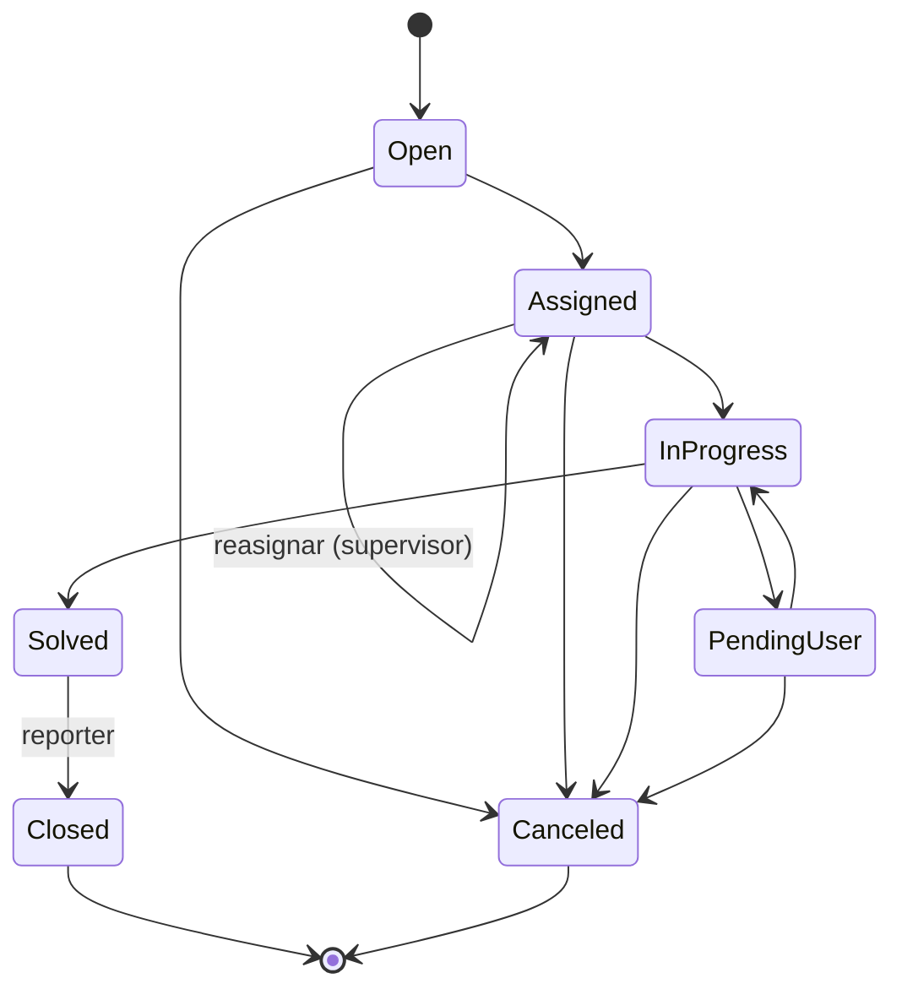

### 6.2 Frontend (SPA)

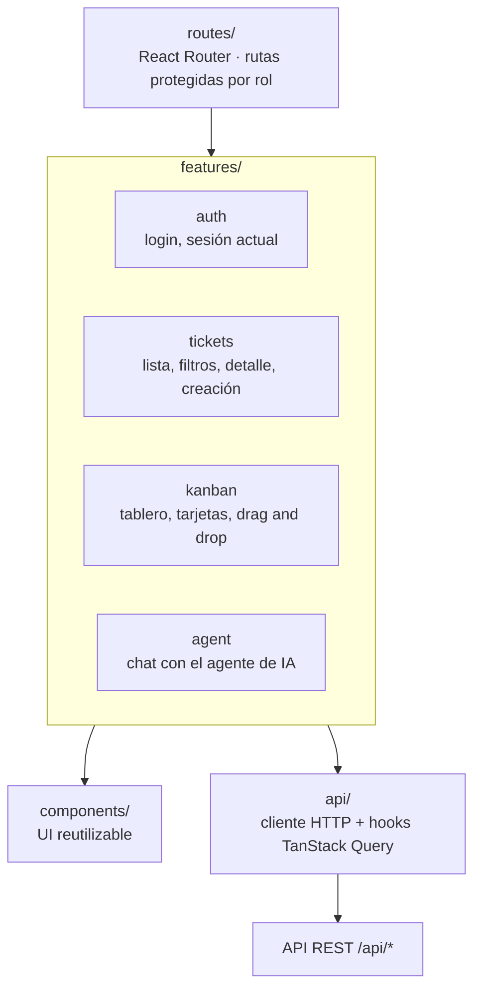

- **Organización por funcionalidad:** cada carpeta de `features/` contiene sus componentes, hooks y tipos.
- **Estado del servidor en TanStack Query** (caché, reintentos, invalidación); no hay un store global para datos del backend. Los filtros viven en la URL.
- **Actualización optimista** en el Kanban: la tarjeta se mueve al instante y se revierte si la API devuelve error.
- **El frontend no replica reglas de negocio:** pregunta a la API qué transiciones están disponibles. La única excepción es la vista previa de la prioridad en el formulario, que replica la fórmula y se comprueba con un test.

### 6.3 Estructura del repositorio

Monorepo con npm workspaces ([ADR](docs/adr/20260924-monorepo-con-npm-workspaces.md)):

```
AI4Devs-finalproject/
├── apps/
│   ├── api/                    # Backend AdonisJS 7 (API REST)
│   │   ├── app/
│   │   │   ├── controllers/    # Capa HTTP: valida, autoriza y delega
│   │   │   ├── validators/     # Esquemas VineJS
│   │   │   ├── policies/       # Autorización por rol (Bouncer)
│   │   │   ├── services/       # Dominio: ticket_workflow, ticket_service, historial
│   │   │   ├── models/         # Modelos Lucid
│   │   │   ├── exceptions/     # Errores de dominio y exception handler
│   │   │   └── agent/          # Agente de IA: cliente LLM y tools de solo lectura
│   │   ├── config/             # Incluida la configuración de adonis-autoswagger
│   │   ├── database/
│   │   │   ├── migrations/
│   │   │   └── seeders/
│   │   ├── start/routes.ts
│   │   └── tests/              # unit/ y functional/ (Japa)
│   └── web/                    # Frontend React 19 + Vite (SPA)
│       ├── src/
│       │   ├── api/
│       │   ├── features/       # auth, tickets, kanban, agent
│       │   ├── components/
│       │   ├── routes/
│       │   └── lib/
│       └── tests/              # Vitest + Testing Library + MSW
├── e2e/                        # Playwright
├── docker/                     # Dockerfiles y configuración de Nginx
├── docker-compose.yml
├── docs/adr/                   # ADRs (MADR)
├── PRD/                        # Requisitos de producto
├── ARQUITECTURA.md             # Este documento
├── AGENTS.md / CLAUDE.md       # Contexto para asistentes de IA
├── biome.json
├── readme.md
└── prompts.md
```

## 7. Vista de ejecución: flujos principales

### 7.1 Inicio de sesión

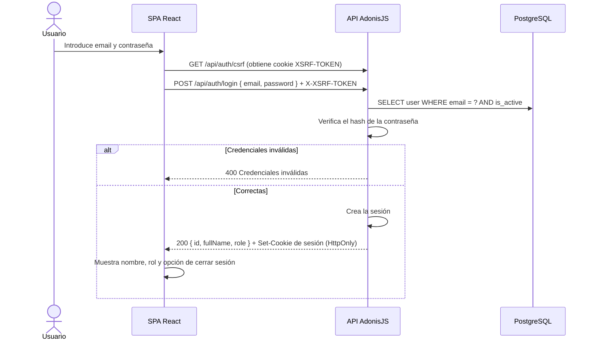

Al recargar, la SPA consulta `GET /api/auth/me`. La API obtiene el rol actual de PostgreSQL y devuelve `401` si la sesión ha caducado o la cuenta se ha desactivado. Para salir, la SPA envía `POST /api/auth/logout` con el token CSRF y vuelve al formulario tras el `204`. El servidor rechaza el acceso con la cookie anterior al cierre.

### 7.2 Crear un ticket

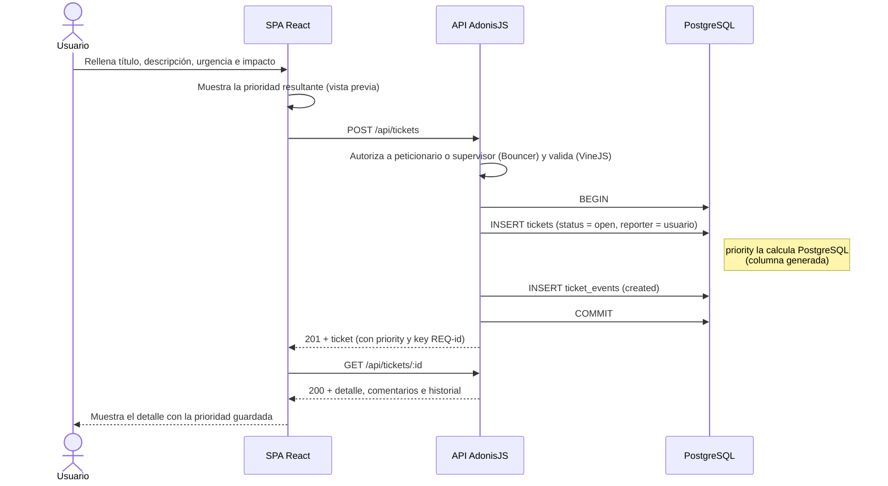

La SPA usa el identificador de la respuesta de creación para abrir `/tickets/:id`. El detalle se consulta desde la API al navegar, abrir la URL directamente o recargar.

### 7.3 Cambiar el estado de un ticket

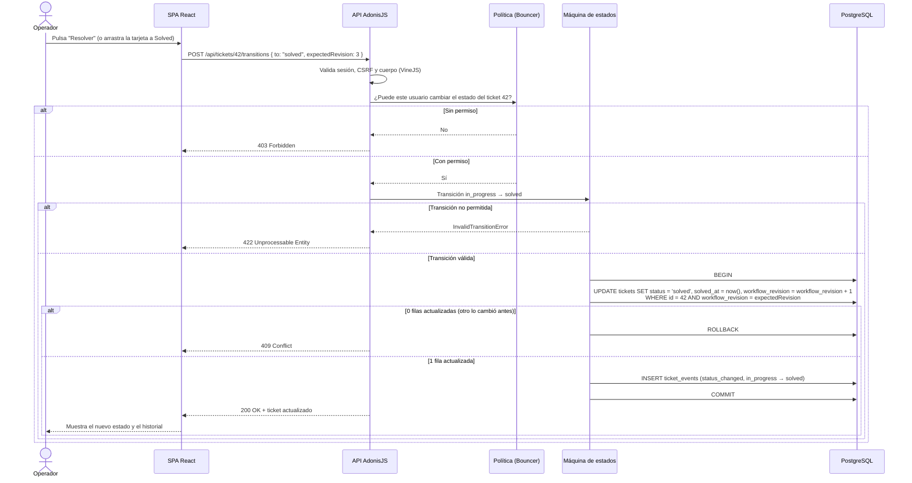

### 7.4 Consulta al agente de IA (should-have)

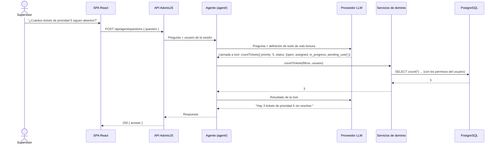

El endpoint del agente y el catálogo exacto de herramientas se definirán al abordar HU-06.

## 8. Datos

El modelo completo, con tipos, restricciones e índices, está en la **sección 3 del `readme.md`**. Resumen:

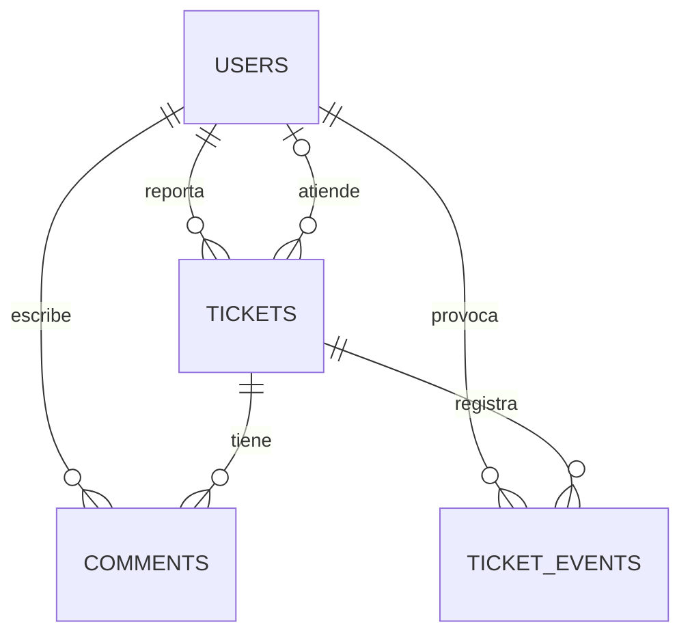

Principios de diseño de datos:
- **Integridad en la base de datos**, no solo en la aplicación: enums nativos, `CHECK` de rangos y de assignee obligatorio desde `assigned`, FKs con `RESTRICT`.
- **Prioridad como columna generada `STORED`**: `ceil(urgency * impact / 5.0)`, indexable y nunca desincronizada.
- **Revisión del flujo**. `tickets.workflow_revision` empieza en cero para tickets nuevos y existentes. Se incrementa al cambiar de estado o asignación.
- **Historial como tabla de eventos inmutable** (`ticket_events`), escrita en la misma transacción que el cambio.
- **Sin borrado físico de tickets:** se cancelan. Los usuarios se desactivan (`is_active`), no se borran.
- **Migraciones reversibles** y seeders con datos para los tres roles.

## 9. API

El contrato de diseño de tickets y el resumen de HU-00 están en la **sección 4 del `readme.md`**. AdonisJS publica el contrato implementado de sesión, creación y detalle de tickets en `/api/openapi.json` y la referencia Scalar en `/docs`. El build genera el JSON con `adonis-autoswagger` y lo copia como artefacto. El navegador carga el script de Scalar desde el mismo origen.

Convenciones:
- Rutas bajo `/api`, recursos en plural (`/tickets`) y acciones de flujo como subrecurso (`/tickets/:id/transitions`).
- `GET /api/tickets/:id` aplica la visibilidad en la consulta de PostgreSQL y devuelve el ticket, `comments` e `history` desde la misma instantánea. Ambas colecciones se ordenan de más antigua a más reciente; el identificador desempata fechas iguales. La API devuelve el mismo `404` para un ticket inexistente y para uno fuera de la visibilidad.
- `GET /api/tickets/:id/transitions` devuelve los destinos permitidos para el usuario de la sesión y si cada transición requiere indicar un operador. Devuelve `200` con `[]` si el ticket es visible y el usuario no tiene transiciones disponibles.
- `GET /api/tickets/:id/eligible-assignees` ofrece al supervisor los operadores activos disponibles para asignar o reasignar el ticket. Excluye al operador ya asignado y devuelve solo identificador y nombre.
- El detalle muestra las acciones devueltas por la API. Tras guardar actualiza el ticket y vuelve a consultar las acciones. Ante `409` recupera el detalle y las opciones vigentes sin reintentar la escritura.
- El detalle devuelve `workflowRevision` y la escritura exige `expectedRevision`. La API actualiza el estado y el asignado con una comparación de revisión y guarda las marcas de tiempo y los eventos en esa misma transacción.
- JSON con claves en *camelCase*. Los identificadores de ticket y usuario se representan como cadenas decimales para conservar la precisión de PostgreSQL.
- Códigos: `200`/`201` éxito, `401` sin sesión, `403` sin permiso, `404` no existe o no es visible, `409` conflicto de concurrencia, `422` validación o transición inválida.
- Errores de validación en formato VineJS (`{ errors: [{ field, rule, message }] }`); errores de negocio como `{ code, message }`.
- Listados paginados con `{ meta, data }`, filtros por query string y orden con `sort` (`-` para descendente).

## 10. Infraestructura y despliegue

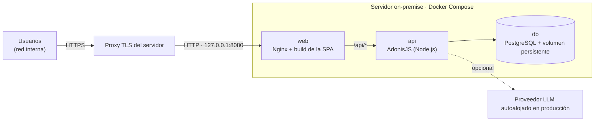

| Entorno | Cómo se ejecuta |
|---------|-----------------|
| **Local** | `docker compose -f compose.dev.yml up api web` arranca también PostgreSQL con volumen persistente. La web consulta `/api/health` a través de Vite y AdonisJS comprueba PostgreSQL. |
| **CI** | GitHub Actions ejecuta comprobaciones y compilación con Node 24, Japa y Vitest con PostgreSQL temporal y los E2E con Chromium. Se dispara en PR hacia `main` o `final-project-PLL` y en pushes a `final-project-PLL`. Si falla Playwright, las trazas disponibles se guardan como artefacto durante siete días. |
| **On-premise** | `compose.deploy.yml` con `web`, `api` y `db`. Publica la web en loopback para el proxy TLS del servidor y usa un volumen persistente de PostgreSQL. |
| **Demo (entrega final)** | Revisión local con datos sintéticos y los pasos del README. |

La CI también bloquea los hallazgos de Gitleaks en los commits introducidos y las vulnerabilidades altas o críticas del lockfile de npm.

**Proceso de despliegue:**
1. Desde la raíz se construyen las imágenes con `docker/web.Dockerfile` y `docker/api.Dockerfile`. La web sirve la SPA compilada con Nginx y reenvía `/api/` y `/docs` a la API. La imagen de la API arranca la compilación de AdonisJS con Node 24 y un usuario sin privilegios.
2. A partir de `docker/deploy.env.example`, configura la URL HTTPS y los secretos en el archivo local `.env.deploy`. Levanta los servicios con `docker compose --env-file .env.deploy -f compose.deploy.yml up --build -d --wait`.
3. PostgreSQL debe estar listo antes del arranque de la API. La API aplica las migraciones pendientes. Nginx comprueba la salud a través de `/api/health`, que a su vez comprueba PostgreSQL.
4. El proxy TLS del servidor reenvía la URL pública de la aplicación al puerto local de la web. API y PostgreSQL solo reciben conexiones por la red de Compose.

**Copias de seguridad (asumido):** volcado periódico de PostgreSQL (`pg_dump`) a un almacenamiento de la empresa. Se concretará con el despliegue.

## 11. Conceptos transversales

### 11.1 Seguridad

- **Autenticación:** sesión con cookie `HttpOnly`, `SameSite=Lax` y `Secure` en producción. AdonisJS guarda la sesión cifrada en la tabla técnica `sessions` de PostgreSQL y comprueba contraseñas con scrypt. El cierre revoca el acceso en el servidor. Docker Compose de desarrollo aplica las migraciones antes de arrancar la API.
- **CSRF:** shield de AdonisJS; la SPA envía `X-XSRF-TOKEN` en las peticiones que modifican datos.
- **Autorización en el servidor:** políticas Bouncer y máquina de estados. La interfaz oculta acciones, pero la API las valida siempre.
- **Validación de entradas** con VineJS en todos los endpoints; `additionalProperties: false` en los cuerpos.
- **Sin SQL manual:** acceso a datos con Lucid y parámetros.
- **Agente de IA:** herramientas de solo lectura, ejecutadas con los permisos del usuario que pregunta; nunca SQL libre. Mitiga la inyección de prompts y la fuga de datos.
- **Secretos** en variables de entorno.

### 11.2 Gestión de errores

Errores de dominio tipados en los servicios, traducidos a HTTP en un único *exception handler*. La SPA muestra el `message` y, en el Kanban, revierte la acción.

### 11.3 Concurrencia

Control optimista en las transiciones: el `UPDATE` incluye el estado de origen; si no actualiza ninguna fila, se responde `409` y la SPA recarga el ticket.

### 11.4 Observabilidad (asumido)

Logs estructurados en JSON (logger de AdonisJS) con id de petición, usuario y ticket. El historial del ticket cubre la auditoría funcional.

### 11.5 Tests

| Nivel | Herramienta | Qué cubre |
|-------|-------------|-----------|
| Unitario | Japa | Máquina de estados (todas las combinaciones estado × destino × rol) y cálculo de la prioridad. |
| Integración / funcional | Japa + PostgreSQL de test | Endpoints de la API, permisos y códigos de error; restricciones de la base de datos. |
| Componentes | Vitest + Testing Library + MSW | Formularios, filtros y comportamiento del Kanban ante errores. |
| End-to-end | Playwright | Chromium verifica la sesión y el recorrido de creación, autoasignación, inicio, resolución y cierre por el reportero con cuentas separadas. La web, la API y PostgreSQL temporal se ejecutan en Compose. |

### 11.6 Calidad y documentación

- **Biome** y `tsc --noEmit` en CI.
- **Docs-as-code:** este documento, los ADRs y el `readme.md` se actualizan en la misma PR que el cambio.
- **OpenAPI** generada desde el código; **TSDoc** en métodos públicos de servicios y controllers.
- Diagramas en **Mermaid**. Si el sistema crece a más contenedores, se valorará un modelo **Structurizr DSL** en `docs/architecture/workspace.dsl`.

## 12. Decisiones de arquitectura (ADRs)

Formato MADR, en [`docs/adr/`](docs/adr/README.md):

| Fecha | Decisión | Estado |
|-------|----------|--------|
| 24/09/2026 | [SPA React + API REST en lugar de AdonisJS + Inertia](docs/adr/20260924-spa-react-y-api-rest-en-lugar-de-inertia.md) | Aceptado |
| 24/09/2026 | [Autenticación por sesión con cookie en lugar de tokens de acceso](docs/adr/20260924-autenticacion-por-sesion-con-cookie.md) | Aceptado |
| 24/09/2026 | [Monorepo con npm workspaces](docs/adr/20260924-monorepo-con-npm-workspaces.md) | Aceptado |
| 24/09/2026 | [Prioridad calculada como columna generada en PostgreSQL](docs/adr/20260924-prioridad-como-columna-generada.md) | Aceptado |
| 24/09/2026 | [Agente de IA con herramientas de solo lectura y proveedor LLM configurable](docs/adr/20260924-agente-ia-solo-lectura-y-proveedor-configurable.md) | Aceptado |

Cada decisión nueva de peso se registra como ADR y se añade a esta tabla.

## 13. Riesgos, deuda técnica y puntos abiertos

| Riesgo o punto abierto | Impacto | Mitigación |
|------------------------|---------|------------|
| AdonisJS 7 es reciente y los modelos de IA la conocen poco. | Código generado para AdonisJS 6 que no funciona. | Context7 MCP y revisión humana ([`AGENTS.md`](AGENTS.md)). |
| Proveedor LLM sin decidir; los modelos locales soportan peor el *tool calling*. | HU-06 puede crecer o no cumplir el requisito on-premise. | Interfaz de proveedor común; HU-06 es should-have. |
| Aplicación incoherente de las reglas de visibilidad y transición. | La lista, el detalle y las acciones pueden discrepar sobre los permisos. | Política de visibilidad común y pruebas basadas en la matriz del PRD. |
| Un único servidor, sin redundancia. | Caída del servicio si falla el servidor. | Aceptado para el MVP; copias de seguridad de la base de datos. |
| Escalado del listado con muchos tickets. | Lentitud en lista y Kanban. | Índices en los campos filtrados y paginación; búsqueda de texto completo si hace falta. |

## 14. Glosario

| Término | Significado |
|---------|-------------|
| **Request** | Único tipo de ticket que gestiona Requesto. |
| **Reporter** | Usuario que abrió el ticket. |
| **Assignee** | Operador asignado al ticket. |
| **Transición** | Cambio de un estado a otro del flujo. |
| **Máquina de estados** | Componente del backend que define qué transiciones existen y quién puede hacerlas. |
| **Historial** | Registro inmutable de eventos de un ticket (`ticket_events`). |
| **ADR** | *Architecture Decision Record*: documento corto que registra una decisión técnica y su porqué. |
| **C4** | Modelo de diagramas de arquitectura por niveles: contexto, contenedores, componentes y código. |
| **Tool calling** | Capacidad de un LLM de pedir la ejecución de funciones definidas por la aplicación. |
