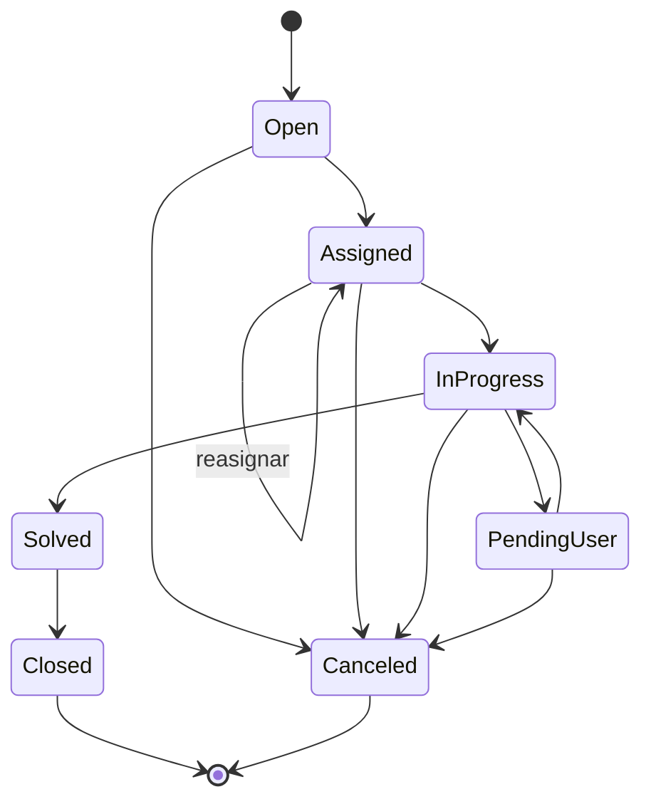

# Requesto — PRD

> Documento de requisitos de producto. Nació de las notas manuscritas del autor y se ha actualizado con las decisiones tomadas al documentar la entrega 1 (`readme.md`, secciones 1, 3, 4 y 5).
>
> **Versión:** 1.1 · **Fecha:** 24/09/2026 · **Estado:** base para la entrega 2.
>
> Los puntos marcados **(asumido)** no vienen de los requisitos del autor, sino de supuestos tomados al redactar las historias: deben confirmarse. Los puntos marcados **Pendiente** se concretarán en los requisitos que detallan este PRD.

## 1. Problema (driver)

Mi sistema de ticketing está en JSM Data Center. Como Atlassian ha anunciado su fin de vida (EOL) y no quiero ir al Cloud, necesito una alternativa.

**Implicación:** la aplicación debe poder desplegarse **on-premise** (en infraestructura propia), sin depender de un SaaS para funcionar.

## 2. Objetivo y valor

Tener una app web, **Requesto**, para la gestión de mis tickets. No es un clon genérico de JSM: gestiona **un solo tipo de ticket (Request)**, con un formulario fijo y un flujo fijo.

| Valor | Descripción |
|-------|-------------|
| Continuidad | El servicio de tickets sigue funcionando tras el EOL de JSM Data Center. |
| Control de los datos | Los datos de producción se procesan dentro de la infraestructura de la empresa. |
| Simplicidad | Sin tipos de issue, formularios ni workflows configurables que nadie usa. |
| Explotación con IA | Un agente de IA responde preguntas sobre los tickets en lenguaje natural. |

### Métricas de éxito (asumido)

- El flujo completo de un Request (abrir → asignar → resolver → cerrar) se puede hacer en Requesto sin recurrir a JSM.
- Cada cambio de estado o de asignación queda trazado en el historial (quién, cuándo, antes y después).
- Un operador ve de un vistazo su trabajo pendiente, en lista o en Kanban, ordenado por prioridad.

## 3. Usuarios y roles

| Rol | Identificador en código | Necesidad |
|-----|-------------------------|-----------|
| **Usuario** (peticionario) | `requester` | Abrir peticiones, seguir su estado y cerrarlas cuando están resueltas. |
| **Operador** | `agent` | Ver su trabajo pendiente, asignarse peticiones y llevarlas hasta su resolución. |
| **Supervisor** | `supervisor` | Repartir el trabajo entre operadores y tener visibilidad sobre los tickets. |

## 4. Alcance del MVP

Organizado en dos épicas. El detalle de cada historia está en la sección 5 del `readme.md`.

| Id | Funcionalidad | Épica | Prioridad |
|----|---------------|-------|-----------|
| HU-00 | Autenticación y roles (base técnica) | E1 · Ciclo de vida del ticket | Must |
| HU-01 | Crear un ticket | E1 | Must |
| HU-02 | Lista de tickets con filtros | E1 | Must |
| HU-03 | Detalle del ticket con comentarios e historial | E1 | Must |
| HU-04 | Gestionar el flujo de un ticket (asignación y cambios de estado) | E1 | Must |
| HU-05 | Kanban de tickets, con filtros y arrastrar y soltar **(asumido: arrastrar y soltar)** | E1 | Must |
| HU-06 | Explotación de la información mediante un **agente de IA** | E2 · Explotación de la información | Should |
| HU-07 | Dashboard de tickets. **Pendiente:** si será un dashboard propio o lo generará también el agente de IA | E2 | Should |

**Filtros** (lista y Kanban): estado, prioridad, assignee, reporter, texto libre, "mis tickets" y "sin asignar".

El MVP permite crear, consultar, actualizar y cancelar tickets. Cuando un ticket ya no procede, se cancela y pasa a `Canceled`, con su historial disponible para consulta.

### Fuera de alcance del MVP

- Tipos de ticket, formularios o workflows configurables.
- Adjuntos en los tickets.
- Notificaciones (email o en la aplicación).
- SLA, alertas por tiempo y escalados.
- Acciones masivas sobre varios tickets.
- Actualización en tiempo real entre usuarios.
- Migración de los datos existentes en JSM.
- Borrado físico de tickets desde la aplicación.

## 5. El ticket de tipo Request

| Campo | Valor / tipo |
|-------|--------------|
| Id | Identificador numérico automático. Se muestra como `REQ-<id>`. |
| Tipo | `Request` (fijo). |
| Título | Texto, obligatorio, máximo 200 caracteres. |
| Descripción | Texto largo, obligatorio. |
| Reporter | Usuario que abre el ticket. Automático. |
| Assignee | Operador asignado. Vacío hasta que se asigna; obligatorio a partir de `Assigned`. |
| Estado | Ver "Flujo de estados". Al crearse: `Open`. |
| Urgencia | 1-5. |
| Impacto | 1-5. |
| Prioridad | Automática, 1-5. No se introduce a mano. |
| Fecha de creación | Automática. |
| Fecha de resolución / cierre | Automáticas, al pasar a `Solved` y a `Closed` o `Canceled`. |
| Historial | Automático: registro de cada creación, cambio de estado, asignación y cambio de campos. |
| Comentarios | Lista de comentarios, cada uno con su autor y fecha. |

### Cálculo de la prioridad

Urgencia × Impacto da un valor entre 1 y 25, que se reescala a 1-5:

`prioridad = ceil(urgencia × impacto / 5)`

| Urgencia × Impacto | Prioridad |
|--------------------|-----------|
| 1-5 | 1 |
| 6-10 | 2 |
| 11-15 | 3 |
| 16-20 | 4 |
| 21-25 | 5 |

## 6. Flujo de estados

Flujo principal: `Open → Assigned → In progress → Solved → Closed`. Estados alternativos: `Pending user` (el operador espera información del usuario) y `Canceled`. `Closed` y `Canceled` son finales: no admiten más transiciones.

| Desde | Hacia | Quién puede |
|-------|-------|-------------|
| `Open` | `Assigned` | Operador (a sí mismo); supervisor (a cualquier operador activo) |
| `Assigned` | `Assigned` (reasignar) | Supervisor (cambia el asignado a un operador activo) |
| `Assigned` | `In progress` | Operador asignado; supervisor |
| `In progress` | `Pending user` | Operador asignado; supervisor |
| `Pending user` | `In progress` | Operador asignado; supervisor |
| `In progress` | `Solved` | Operador asignado; supervisor |
| `Solved` | `Closed` | Reportero del ticket (peticionario o supervisor) |
| `Open`, `Assigned`, `In progress`, `Pending user` | `Canceled` | Reportero; operador asignado; supervisor |

Para asignar o reasignar, la cuenta elegida debe estar activa y tener rol `agent`. El historial registra cambios de estado y de asignación. Una reasignación en `Assigned` registra el cambio de asignado sin generar un evento de cambio de estado.

La vuelta de `Pending user` a `In progress` es manual y corresponde al operador asignado o al supervisor. El reportero puede responder mediante un comentario y el ticket permanece en `Pending user` hasta que se retome el trabajo.

Desde `Solved` solo se puede pasar a `Closed`. Si hace falta retomar el asunto, se abre un ticket nuevo.

## 7. Roles y permisos

### Visibilidad de tickets

| Rol | Tickets que puede consultar |
|-----|-----------------------------|
| Peticionario (`requester`) | Los tickets que ha abierto, en cualquier estado. |
| Operador (`agent`) | Los tickets que tiene asignados, en cualquier estado, y los tickets `Open` sin asignar. |
| Supervisor (`supervisor`) | Todos los tickets. |

La API aplica la misma regla a la lista, el detalle, los comentarios, el historial y la consulta de transiciones disponibles. Cada acción comprueba además sus propios permisos.

### Edición de campos

El reportero puede editar el título, la descripción, la urgencia y el impacto de su ticket mientras esté en `Open`. Esto se aplica también al supervisor cuando es el reportero. Al cambiar la urgencia o el impacto, la prioridad se recalcula automáticamente. El historial registra los cambios de campos.

| Acción | Usuario | Operador | Supervisor |
|--------|:-------:|:--------:|:----------:|
| Abrir un ticket | ✅ | ❌ | ✅ |
| Comentar en un ticket **(asumido)** | ✅ | ✅ | ✅ |
| Asignarse un ticket | | ✅ | |
| Asignar un ticket a otro operador | | | ✅ |
| Pasar a *In progress*, *Pending user* o *Solved* | | ✅ | ✅ |
| Cancelar un ticket | ✅ (los suyos) | ✅ | ✅ |
| Cerrar un ticket resuelto | ✅ (los suyos) | | ✅ (los suyos) |
| Usar el Kanban **(asumido)** | ❌ (usa la lista) | ✅ | ✅ |
| Consultar al agente de IA | | ✅ | ✅ |

## 8. Requisitos no funcionales

- **Despliegue on-premise**, sin servicios cloud gestionados que no se puedan autoalojar.
- **Seguridad:** autenticación con sesión; las reglas de flujo y permisos se validan siempre en el servidor, no solo en la interfaz.
- **Trazabilidad:** historial inmutable de todos los cambios del ticket.
- **Consistencia:** si dos personas cambian el mismo ticket a la vez, solo se aplica un cambio y la otra persona recibe un aviso para recargar.
- **Agente de IA acotado:** solo puede leer datos y respeta los permisos de quien pregunta. Si se habilita en producción, usa un proveedor LLM autoalojado en la infraestructura de la empresa. En desarrollo y demos se permite una API externa solo con preguntas y datos sintéticos.
- **Accesibilidad:** el Kanban se puede usar solo con teclado.

## 9. Arquitectura

- **Front:** React (SPA con Vite)
- **Back:** AdonisJS 7 (API REST)
- **DB:** PostgreSQL

El detalle está en la sección 2 del `readme.md` y las decisiones justificadas en [`docs/adr/`](../docs/adr/README.md).

## 10. Plan por entregas

| Entrega | Objetivo | Historias |
|---------|----------|-----------|
| 2 · 22/10/2026 | Un usuario abre un ticket y un operador lo lleva hasta resuelto, de principio a fin. | HU-00, HU-01, HU-03, HU-04 |
| 3 · 12/11/2026 | El MVP completo, probado y desplegado on-premise. | HU-02, HU-05; HU-06 y HU-07 si hay capacidad |

## 11. Puntos pendientes

- **Dashboard:** ¿dashboard propio o generado por el agente de IA?
- **Agente de IA:** ¿qué proveedor autoalojado y qué modelo se usarán en producción?
- Confirmar los supuestos marcados **(asumido)** en este documento.
